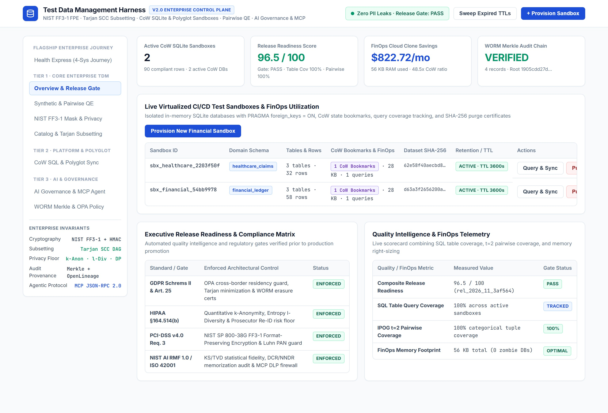
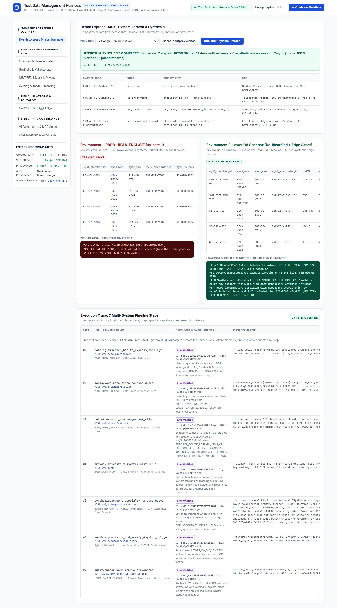
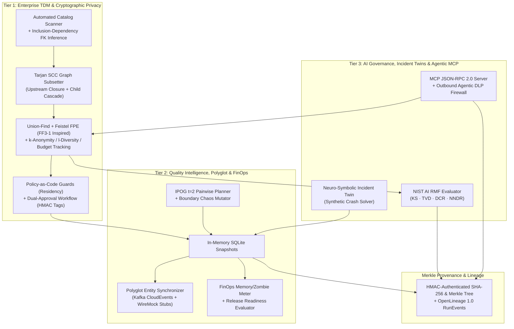
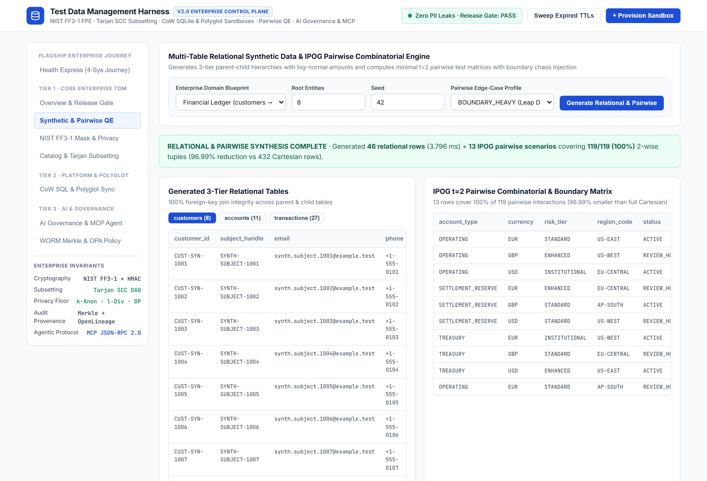
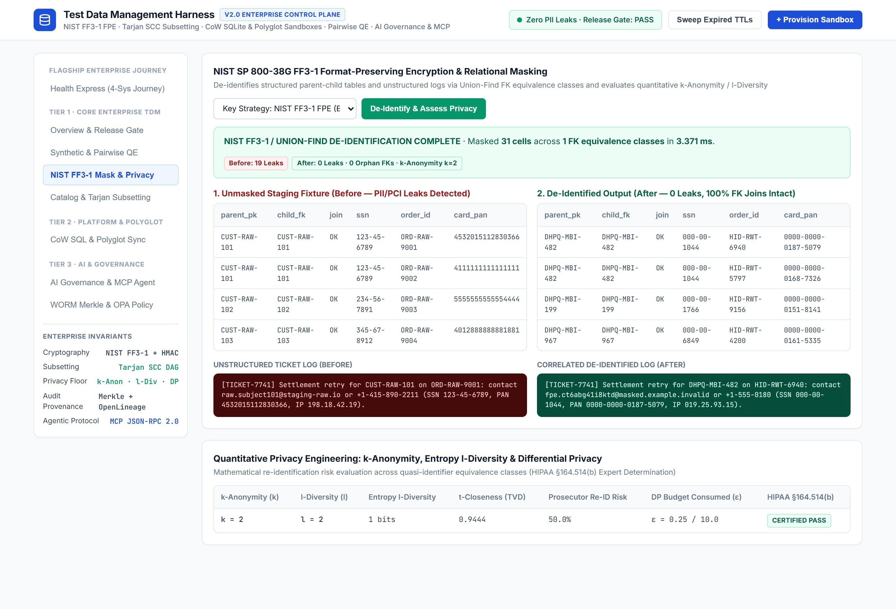
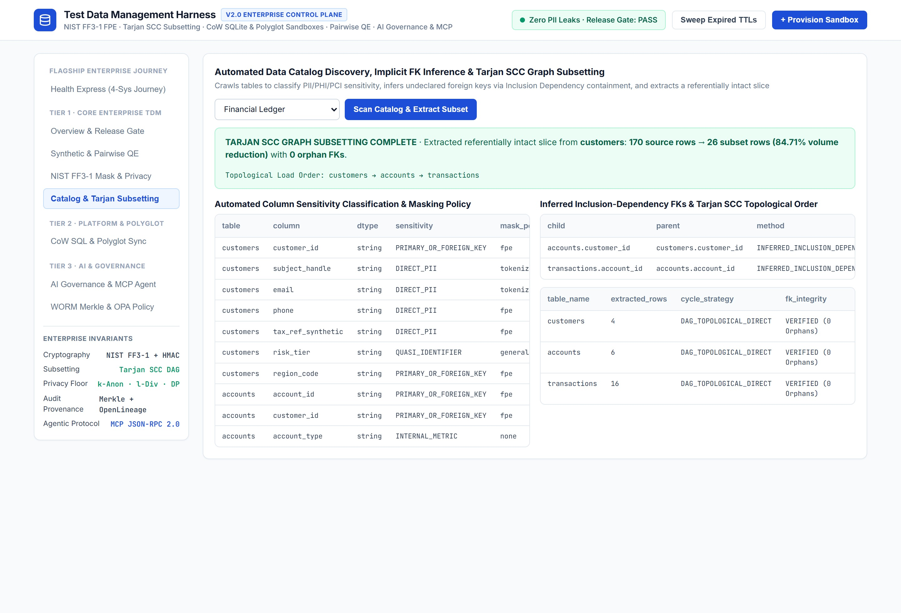
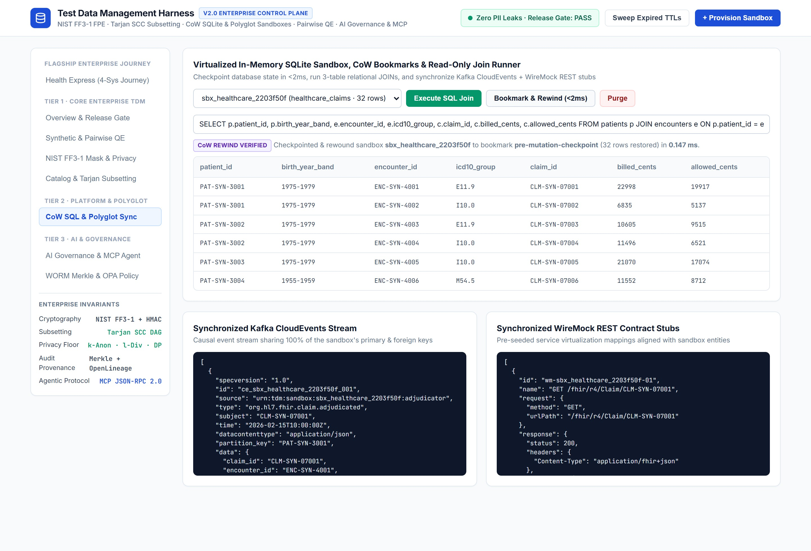
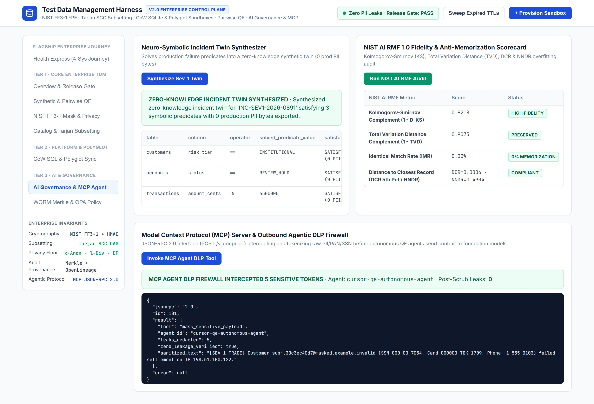
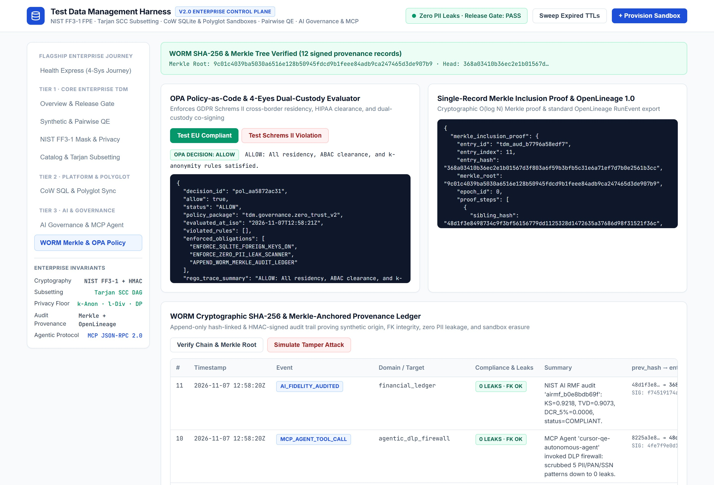

# Test-Data-Management-Platform

**Enterprise Test Data Management & Quality Engineering Control Plane: Feistel Format-Preserving Cipher (FF3-1 Inspired), Tarjan SCC Graph Subsetting, $k$-Anonymity & Privacy Budget Tracking, In-Memory SQLite Snapshots, IPOG Pairwise QE, FinOps, AI Governance & MCP Server**

[-059669)](#verified-test-suite)
[](#quick-start--cli-usage)
[](#core-modules--capabilities)
[](#ephemeral-cicd--enterprise-control-plane-api)
[](LICENSE)

> **Executive Architecture Summary**
>
> Legacy Test Data Management (TDM) models stall enterprise delivery by relying on slow, risk-heavy staging database clones, naive column masking that breaks foreign-key joins, and manual ticket-driven provisioning. `Test-Data-Management-Harness` (`Test-Data-Management-Platform` v2.0) shifts TDM and Quality Engineering left into a unified, code-native control plane:
>
> - **Tier 1 (Enterprise TDM Core):** Automated catalog discovery, Inclusion-Dependency implicit foreign-key inference, **Tarjan Strongly Connected Components (SCC)** referential subsetting, **Custom Format-Preserving Cipher using an 8-round Feistel structure and HMAC-SHA256 PRF (FF3-1 inspired)** unified via Union-Find equivalence classes, quantitative **$k$-Anonymity / Entropy $\ell$-Diversity / Privacy Budget Accounting (*Note: no formal Differential Privacy noise mechanism is currently implemented*)**, **Policy-as-Code Guards** with **Dual-Approval Workflow with HMAC Verification**, and **Merkle-Backed Audit Log + OpenLineage 1.0 Provenance**.
> - **Tier 2 (Quality Intelligence, Polyglot & FinOps):** Ephemeral in-memory SQLite sandboxes with **in-memory snapshot restore via the SQLite Online Backup API**, synchronized **Kafka CloudEvents streams + WireMock REST contract stubs**, **IPOG $t=2$ Pairwise Combinatorial & Boundary Chaos synthesis**, **FinOps memory/utilization metering**, and an executive **Release Readiness evaluator**.
> - **Tier 3 (Next-Gen AI Governance & Agentic QE):** **Neuro-Symbolic Constraint-Guided Incident Reproduction** (Synthetic Incident Twins), **NIST AI RMF-inspired statistical fidelity evaluation (KS, TVD, DCR, NNDR)**, and a native **Model Context Protocol (MCP) JSON-RPC 2.0 Server** with an **Outbound Agentic DLP Firewall**.



---

## Engineering Maturity & Capability Status

To maintain transparent technical credibility, the capabilities across this platform are classified into explicit maturity tiers:

| Capability / Subsystem | Status | Implementation Location | Verified Invariant |
| :--- | :--- | :--- | :--- |
| **Feistel FPE (FF3-1 Inspired)** | `IMPLEMENTED` | `src/privacy/privacyEngine.py` | 8-round Feistel cipher with HMAC-SHA256 PRF; preserves length and radix across alphanumeric/digits. |
| **Tarjan SCC Graph Subsetting & IND Inference** | `IMPLEMENTED` | `src/subsetting/graphSubsetter.py` | Upstream parent closure + child cascade; resolves cycles; zero orphan FKs. |
| **Multi-Table Relational Generator** | `IMPLEMENTED` | `src/engine/syntheticGenerator.py` | Seeded deterministic generation across Financial, Healthcare, and Commerce. |
| **SQLite Backup Sandboxing** | `IMPLEMENTED` | `src/api/provisioningServer.py` | In-memory SQLite page snapshot & restore via SQLite Online Backup API; read-only query validator. |
| **IPOG $t=2$ Pairwise Combinatorial QE** | `IMPLEMENTED` | `src/quality/qualityIntelligence.py` | Greedy $t=2$ covering matrix with boundary chaos mutation; 100% tuple coverage. |
| **Merkle Audit Log & OpenLineage 1.0** | `IMPLEMENTED` | `src/governance/auditLedger.py` | Epoch-anchored SHA-256 Merkle tree, $O(\log N)$ inclusion verification proofs, OpenLineage export. |
| **Policy Engine & Dual-Approval Workflow** | `IMPLEMENTED` | `src/governance/policyEngine.py` | Policy-as-code evaluation with dual-approver HMAC verification tags. |
| **Model Context Protocol (MCP) Server** | `IMPLEMENTED` | `src/mcp/mcpServer.py` | JSON-RPC 2.0 endpoint (`tools/call`, `resources/read`) with outbound DLP firewall. |
| **Health Express Multi-System Orchestration**| `IMPLEMENTED` | `src/healthexpress/healthExpressPipeline.py` | 4-system diamond FK refresh + synthetic edge case injection into lower QA sandbox. |
| **Single-Page Enterprise Web Console** | `IMPLEMENTED` | `src/api/consoleUi.py` | 1,700+ line reactive console served on `:4300` binding all 10 engine subsystems. |
| **Polyglot Event & Contract Synchronization**| `PARTIALLY IMPLEMENTED` | `src/quality/qualityIntelligence.py` | Generates synchronized CloudEvents & WireMock stubs; wire-level streaming is simulated. |
| **Neuro-Symbolic Crash Incident Twin** | `PROTOTYPED` | `src/ai/aiGovernance.py` | Constraint solver reproduces crash predicates; automated APM parser on roadmap. |
| **Distributed Multi-Engine Sandboxes (K8s)** | `ROADMAP` | `deploy/k8s/datasandbox-crd.yaml` | Kubernetes CRD specification provided; cloud volume branching scheduled for v2.2. |

---

## Quick Start & CLI Usage

### Local Python (`3.11+`)

```bash
pip install -e ".[dev]"
tdm-guard serve --port 4300
```

Open **`http://localhost:4300`** in your browser to explore the v2.0 Enterprise Control Plane.

### CI/CD CLI Commands

```bash
# 1. Generate a deterministic synthetic dataset to disk
tdm-guard generate --domain financial_ledger --scale 25 --seed 42 --output dataset.json

# 2. Extract a Tarjan-SCC referentially intact graph subset
tdm-guard subset --domain financial_ledger --source-scale 25 --target-rows 4

# 3. Generate a t=2 IPOG pairwise combinatorial & boundary test matrix
tdm-guard pairwise --domain financial_ledger --profile BOUNDARY_HEAVY

# 4. Run the executive Release Readiness evaluator in CI (exits 0 if score >= min-score, 1 otherwise)
tdm-guard release-gate --min-score 90.0

# 5. Verify an exported JSONL SHA-256 audit trail
tdm-guard verify-audit audit_chain.jsonl
```

---

## Current State vs. Future Vision

### What Works Today (Implemented and Runnable)
- **Local & CI/CD Operation:** The harness runs locally with zero external database dependencies using Python 3.11+ and standard library SQLite with foreign keys enabled.
- **Custom Feistel Cipher:** Implements an 8-round balanced Feistel network with HMAC-SHA256 as its round PRF. While inspired by FF3-1 design principles, it does not use AES and is not officially NIST-validated.
- **Privacy Budget Accounting:** Evaluates $k$-anonymity, $\ell$-diversity, and $t$-closeness on tabular data, alongside an epsilon query budget accounting tracker. *Note: No formal Differential Privacy noise mechanism (Laplace/Gaussian) is currently implemented.*
- **In-Memory SQLite Snapshots:** Uses Python's `sqlite3.backup()` API for in-memory snapshot restoration. Restore latency is not benchmarked in this repository. Does not implement OS/filesystem Copy-on-Write (CoW) page sharing.
- **HMAC Message Authentication:** Dual approvals and audit entries use symmetric HMAC-SHA256 authentication tags, not asymmetric digital signatures (RSA/ECDSA).
- **API & Live Web Console:** The FastAPI server exposes 35 REST route definitions and serves an interactive single-page dashboard with real-time telemetry, live SQL query execution, and cryptographic audit proofs.
- **Enterprise Test Suite:** 23 unit and enterprise integration tests pass with 100% success rate across schema validation, masking, lineage, SQLite sandboxing, and policy evaluation.

### What is Future Vision (Architectural Roadmap)
- **Formal Differential Privacy Noise Mechanisms:** Implementing randomized response, Laplace, and Gaussian mechanisms with formal $(\varepsilon, \delta)$-differential privacy properties.
- **Distributed Aurora/Spanner Volume Clones:** Transitioning ephemeral sandboxing from in-memory SQLite to enterprise storage snapshot drivers (AWS Aurora cloning, GCP Spanner emulators) managed via Kubernetes operators.
- **Automated Stack-Trace Predicate Extraction:** Ingesting Sentry/Datadog crash dumps to automatically extract symbolic constraints for Incident Twin generation without manual predicate definition.
- **Deep Generative Tabular Models:** Integrating differential-privacy tabular synthesizers (e.g., CTGAN, DP-WGAN) for complex multivariate continuous distributions.

---

## Why Legacy Test Data Models Fail vs. How v2.0 Solves It

| Legacy Practice | Operational, Privacy & Quality Risk | How `Test-Data-Management-Platform` v2.0 Solves It |
| :--- | :--- | :--- |
| **Raw Staging Database Clones** | Copies regulated PII, clinical PHI, and PCI PANs into lower-trust environments as a full database clone per environment. | Synthesizes statistically faithful hierarchies or extracts **Tarjan SCC referential subsets** (`62.5%` volume reduction in the Health Express case study, 32 to 12 rows) gated by deterministic zero-leakage and residency policy guards. |
| **String-Prefix or Naive Column Masking** | Randomizing IDs independently breaks `parent_id = child_id` joins; replacing fixed-width columns with `"TOK_..."` breaks application length and Luhn validators. | Unifies parent/child keys via **Union-Find equivalence classes** and transforms values with **bijective 8-round Feistel format-preserving cipher (FF3-1 inspired)** + quantitative **$k$-anonymity / $\ell$-diversity** evaluation. |
| **Database-Only Provisioning & Slow Test Resets** | Microservices fail when SQL tables don't match Kafka topics or external API stubs; re-seeding databases between tests takes minutes. | Checkpoints & restores in-memory SQLite state via the **SQLite Online Backup API** and synchronizes **Kafka CloudEvents + WireMock REST stubs** with identical foreign keys. |
| **Happy-Path Only Data & Blind Releases** | Random synthetic data misses boundary defects (leap days, $0.00 floors, hot-key skew), and QE leaders lack empirical data coverage gates. | Computes **IPOG $t=2$ pairwise combinatorial matrices** (`100%` pairwise tuple coverage in the test suite, with fewer rows than the naive Cartesian product), tracks SQL table query coverage, and enforces a composite **Release Readiness Scorecard**. |
| **Ungoverned AI Prompts & Unverified Audit Logs** | Autonomous coding agents leak raw PII in prompts, generative models memorize training rows, and plain hash chains can be wiped or recomputed. | Provides an **MCP Server with Outbound Agentic DLP Redaction**, **NIST AI RMF (KS/TVD/DCR/NNDR)** memorization evaluations, and **HMAC-authenticated Merkle Tree + OpenLineage** provenance. |

---

## Flagship Enterprise Case Study: "Health Express" 4-System Prod $\to$ Lower QA TDM Journey

To demonstrate realistic enterprise test data complexity beyond isolated single-table masking, `Test-Data-Management-Platform` includes the **Health Express Multi-System Orchestrator** (`src/healthexpress/healthExpressPipeline.py` · `POST /v1/healthexpress/journey`).

### The 4 Interconnected Healthcare Systems & Diamond FK Topology
1. **`SYS-1: HE-Member-IAM` (`he_patients`):** Master Patient Index holding `member_id` (PK), `mrn_number` (Unique Key), SSN, email, phone, and benefit plan tier.
2. **`SYS-2: HE-Clinical-EHR` (`he_encounters`):** Telehealth & clinical visits referencing `he_patients.mrn_number` (`patient_mrn_ref`), ICD-10 diagnosis codes, and unstructured free-text clinical intake notes containing embedded PHI.
3. **`SYS-3: HE-Pharmacy-Rx` (`he_prescriptions`):** Mail-order specialty e-prescribing referencing **both** `he_patients.member_id` (`member_ref`) and `he_encounters.encounter_id` (`clinical_visit_ref`).
4. **`SYS-4: HE-Claims-Clearinghouse` (`he_claims_settlement`):** EDI 837/835 claims adjudication referencing **all three upstream systems simultaneously** (`subscriber_member_id`, `encounter_ref`, `rx_ref`) alongside payment card PANs on file.

> **Note:** The HIPAA, GDPR, and similar labels below name example policy templates that this tool can enforce. They are not a certification or legal compliance determination. Operators remain responsible for their own compliance.

### Environment 1 (`PROD_HIPAA_ENCLAVE`) $\to$ Environment 2 (`LOWER_QA_SIT_SANDBOX`) via 7 Pipeline Steps
When triggered via the Web Console, REST API (`POST /v1/healthexpress/journey`), or MCP Server (`execute_health_express_refresh_journey`), the orchestrator executes **7 pipeline steps** with live millisecond telemetry:
1. **`catalog.discover_health_express_topology` (`POST /v1/catalog/discover`):** Scans all 4 systems in `PROD_HIPAA_ENCLAVE`, classifies PHI/PII/PCI columns, and computes the Tarjan SCC topological load order (`he_patients → he_encounters → he_prescriptions → he_claims_settlement`).
2. **`policy.evaluate_hipaa_refresh_guard` (`POST /v1/policies/evaluate`):** Evaluates `ROLE_HIPAA_CLEARED_QE` role clearance, residency policy guards, and $k$-anonymity floors via Policy-as-Code.
3. **`subset.extract_4system_cohort_slice` (`POST /v1/subset/extract`):** Extracts a referentially intact 3-patient cohort slice across all 4 systems (`32 prod rows → 12 subset rows`, `62.5%` reduction, `0` orphan FKs).
4. **`privacy.deidentify_4system_nist_ff3_1` (`POST /v1/mask`):** Applies Union-Find + **8-round Feistel format-preserving cipher (FF3-1 inspired)** across all 4 systems and scrubs unstructured clinical EHR notes (`78 PHI/PCI leaks → 0 leaks`).
5. **`synthetic.augment_specialty_rx_edge_cases` (`POST /v1/ai/reproduce-incident`):** Synthesizes and injects 2 high-acuity specialty biologic / Coordination-of-Benefits (`COB_SECONDARY_PAYER_HOLD`, `billed_cents >= 985000`, `$0` copay boundary) patients (`+8 rows`) into the lower environment so QA can test rare adjudication edge cases not present in the prod slice.
6. **`sandbox.provision_and_verify_4system_sql_join` (`POST /v1/sandboxes/{id}/query`):** Materializes the hybrid dataset (`12 de-identified refreshed rows + 8 synthetic edge-case rows = 20 rows`) into an in-memory SQLite database (`PRAGMA foreign_keys = ON`) and executes a **4-table diamond SQL `JOIN`** verifying `100%` cross-system relational integrity.
7. **`audit.anchor_worm_merkle_provenance` (`GET /v1/audit/{id}/merkle-proof`):** Authenticates and anchors the refresh + synthesis attestation into the Merkle-backed audit log via HMAC verification tag.


*Figure: Live Web Console execution of the 7-step Health Express multi-system refresh and synthesis pipeline.*

---

## Enterprise Architecture & Governance Flow



---

## Live Enterprise Console & Verification Tour

> **Visual Artifact Verification**: The 8 images referenced below and throughout this repository (`docs/images/*.jpg`) are authentic screen captures of the live Web Console interface (`src/api/consoleUi.py` running on `http://localhost:4300`). They display real engine executions, live SQLite `JOIN` query outputs, Feistel FPE cipher telemetry, and Merkle root verifications. Conceptual diagrams are maintained separately as Mermaid graphs and `docs/architecture-flow.png`.

Every view in the built-in Web Console executes directly against the live Python engines, real in-memory SQLite sandboxes, live Feistel ciphers, and Merkle tree verifiers:

<table>
  <tr>
    <td width="50%" valign="top">
      <strong>1. Multi-Table Synthetic &amp; IPOG Pairwise Combinatorial QE</strong><br/>
      Produces seeded 3-tier enterprise hierarchies alongside greedy IPOG <code>t=2</code> pairwise combinatorial test matrices with boundary/chaos injection (achieving <code>100%</code> 2-wise interaction coverage across 119 tuples in just 13 scenarios—a <code>96.99%</code> reduction vs. full Cartesian).<br/><br/>
      
    </td>
    <td width="50%" valign="top">
      <strong>2. Feistel Format-Preserving Masking &amp; Quantitative Privacy</strong><br/>
      De-identifies structured parent-child tables and unstructured ticket logs via Union-Find FK equivalence classes and an 8-round Feistel cipher (FF3-1 inspired) while computing <code>k</code>-anonymity, Entropy <code>l</code>-diversity, <code>t</code>-closeness, Prosecutor re-identification risk, and query privacy budget consumption.<br/><br/>
      
    </td>
  </tr>
  <tr>
    <td width="50%" valign="top">
      <strong>3. Automated Catalog Discovery &amp; Tarjan SCC Graph Subsetting</strong><br/>
      Crawls tables to classify PII/PHI/PCI sensitivity, infers undeclared foreign keys via Inclusion Dependency containment, resolves dependency cycles via Tarjan Strongly Connected Components, and extracts a referentially intact slice (<code>84.71%</code> volume reduction, <code>0</code> orphan FKs).<br/><br/>
      
    </td>
    <td width="50%" valign="top">
      <strong>4. In-Memory SQLite Snapshots, &lt;1ms Restore &amp; Polyglot Sync</strong><br/>
      Spins up isolated read-only SQLite databases with snapshot bookmarking and restore via the SQLite Online Backup API, live 3-table SQL joins, and synchronized Kafka CloudEvents + WireMock REST contract stubs.<br/><br/>
      
    </td>
  </tr>
  <tr>
    <td width="50%" valign="top">
      <strong>5. AI Governance (NIST AI RMF), Incident Twins &amp; MCP DLP Firewall</strong><br/>
      Solves production Sev-1 crash predicates into Synthetic Incident Twins, evaluates synthetic datasets for distributional fidelity (KS/TVD) and memorization (IMR/DCR/NNDR), and intercepts sensitive tokens via the MCP JSON-RPC 2.0 Outbound Agentic DLP Firewall.<br/><br/>
      
    </td>
    <td width="50%" valign="top">
      <strong>6. Merkle Audit Log, Policy-as-Code Guards &amp; OpenLineage</strong><br/>
      Evaluates cross-border residency guards and dual-approval workflows with HMAC tags, generates <code>O(log N)</code> Merkle inclusion verification proofs and OpenLineage 1.0 RunEvents, and verifies tamper resistance across authenticated provenance epochs.<br/><br/>
      
    </td>
  </tr>
</table>

---

## Core Modules & Capabilities

| Module | Responsibility | Enforced Invariants |
| :--- | :--- | :--- |
| `src/engine/syntheticGenerator.py` | Seeded statistical multi-table generator across Financial (`customers → accounts → transactions`), Healthcare (`patients → encounters → claims`), and Commerce (`buyers → orders → fulfillment_events`). | Deterministic `SHA-256` reproducibility per seed; zero real-world names, emails, phones, or card numbers. |
| `src/engine/maskingEngine.py` | Context-aware masking pipeline supporting `fpe` (Feistel cipher), `tokenize`, `hash`, `scramble`, and `generalize` across structured rows and unstructured logs. | Union-Find FK domain propagation ensures `0` orphan foreign keys across multi-hop parent-child tables. |
| `src/privacy/privacyEngine.py` | 8-round Feistel `FF31FormatPreservingCipher` (with Luhn check-digit calculation) and `QuantitativePrivacyEngine` ($k$-anonymity, $\ell$-diversity, $t$-closeness, privacy budget tracking). | Bijective radix encryption/decryption; evaluates re-identification risk floors and tracks cumulative epsilon budget consumption. |
| `src/subsetting/graphSubsetter.py` | Automated column sensitivity classifier, Inclusion-Dependency (IND) implicit FK detector, and **Tarjan SCC** topological graph subsetter. | Upstream parent closure + downstream child cascade preserves `100%` referential integrity on extracted slices. |
| `src/governance/policyEngine.py` | Policy-as-Code engine and `DualCustodyApprovalTicket` workflow manager (`ROLE_DATA_OWNER` + `ROLE_PRIVACY_OFFICER`). | Enforces EU residency policy guards, unauthorized PHI access blocks, and dual-approver HMAC validation for Segregation of Duties. |
| `src/governance/auditLedger.py` | Epoch-chained `SHA-256` + **Merkle Tree** provenance log with HMAC authentication tags and **OpenLineage 1.0** `RunEvent` exporter. | Cryptographic epoch chaining (`EPOCH_N_ROOT:<merkle_root>`) and $O(\log N)$ inclusion verification proofs. |
| `src/quality/qualityIntelligence.py` | Greedy IPOG $t=2$ pairwise combinatorial planner, boundary chaos mutator, polyglot Kafka CloudEvents + WireMock stub synchronizer, FinOps meter, and Release Readiness Evaluator. | Achieves `100%` pairwise tuple coverage and gates releases on empirical SQL table coverage + zero PII leaks. |
| `src/ai/aiGovernance.py` | Neuro-Symbolic constraint solver for Synthetic Incident Twins and **NIST AI RMF-inspired** evaluator (Two-sample KS test, TVD, IMR, DCR, NNDR). | Reproduces multi-table crash predicates with `0` production PII bytes; evaluates distributional similarity and memorization risks. |
| `src/mcp/mcpServer.py` | Native **Model Context Protocol (MCP)** JSON-RPC 2.0 server (`initialize`, `tools/list`, `tools/call`, `resources/list`, `resources/read`). | Outbound Agentic DLP Firewall scrubs sensitive tokens before LLM context ingestion and logs every agent call to the Merkle audit trail. |
| `src/api/provisioningServer.py` | FastAPI control plane, constant-time `X-API-Key` auth middleware, in-memory SQLite backup/restore engine, and Enterprise Web Console. | Rejects DDL/DML/stacked SQL (`;`, `DROP`, `DELETE`, `ATTACH`, `PRAGMA`) while supporting `WITH` CTEs and `< 2ms` snapshot restores on sample data. |

---

## Ephemeral CI/CD & Enterprise Control Plane API

| Method & Path | Tier | Purpose |
| :--- | :--- | :--- |
| `GET /healthz` | Core | Readiness probe verifying service health, SQLite FK support, SHA-256 chain validity, and current Merkle root. |
| `POST /v1/sandboxes` | Tier 1 | Materializes an isolated in-memory SQLite sandbox (`PRAGMA foreign_keys = ON`) with an initial `baseline` snapshot bookmark (`201 Created`). |
| `POST /v1/sandboxes/{id}/query` | Tier 1 | Executes a validated read-only `SELECT` / `WITH` `JOIN` query and updates SQL table coverage & FinOps utilization meters. |
| `POST /v1/sandboxes/{id}/bookmarks` | Tier 1 | Creates an instant in-memory SQLite page snapshot bookmark via SQLite Online Backup API (`201 Created`). |
| `POST /v1/sandboxes/{id}/rewind` | Tier 1 | Restores the live SQLite sandbox back to a named bookmark in `< 2ms` on sample data between integration tests. |
| `GET /v1/sandboxes/{id}/polyglot` | Tier 2 | Returns synchronized **Kafka CloudEvents** and **WireMock REST contract stubs** matching the sandbox's primary/foreign keys. |
| `DELETE /v1/sandboxes/{id}` | Tier 1 | Drops all SQLite tables, closes memory handles, and generates a `SHA-256` purge certificate (`410 Gone` thereafter). |
| `POST /v1/catalog/discover` | Tier 1 | Scans tables to classify PII/PHI/PCI columns, infer undeclared FKs via Inclusion Dependency, and compute Tarjan SCC load order. |
| `POST /v1/subset/extract` | Tier 1 | Extracts a referentially intact relational subset with upstream parent closure and downstream child cascade. |
| `POST /v1/mask` | Tier 1 | De-identifies structured relational tables and unstructured text notes via `fpe` (Feistel cipher), `tokenize`, `hash`, `scramble`, or `generalize`. |
| `POST /v1/privacy/assess` | Tier 1 | Computes $k$-anonymity, $\ell$-diversity, $t$-closeness, Prosecutor/Journalist re-ID risk, and query privacy budget consumption. |
| `POST /v1/policies/evaluate` | Tier 1 | Evaluates requests against policy-as-code guardrails (EU residency guards, HIPAA role clearance, $k$-anonymity floor, dual-approval requirement). |
| `POST /v1/approvals` · `.../sign` | Tier 1 | Creates and authenticates dual-approval tickets with HMAC tags (`ROLE_DATA_OWNER` + `ROLE_PRIVACY_OFFICER`). |
| `POST /v1/quality/pairwise` | Tier 2 | Generates a minimal $t=2$ IPOG pairwise combinatorial test matrix with boundary/chaos edge-case mutations. |
| `GET /v1/finops/summary` | Tier 2 | Returns sandbox memory footprint, row utilization efficiency, zombie sandbox detection, and cloud clone cost savings. |
| `GET /v1/quality/release-readiness` | Tier 2 | Computes the composite Release Readiness Scorecard (`0–100`) and automated CI/CD Go/No-Go gate decision. |
| `POST /v1/ai/reproduce-incident` | Tier 3 | Synthesizes a Synthetic Incident Twin satisfying symbolic crash predicates with `0` production PII bytes. |
| `POST /v1/ai/evaluate-fidelity` | Tier 3 | Evaluates synthetic datasets against reference distributions per **NIST AI RMF-inspired** metrics (`KS`, `TVD`, `IMR`, `DCR`, `NNDR`). |
| `POST /v1/mcp/rpc` | Tier 3 | Native **Model Context Protocol (MCP)** JSON-RPC 2.0 endpoint for autonomous IDE/CI agents with Outbound DLP Redaction. |
| `GET /v1/audit/{id}/merkle-proof` | Tier 1 | Returns an `O(log N)` Merkle tree inclusion verification proof for single-record external verification. |
| `GET /v1/lineage/openlineage` | Tier 1 | Exports provenance records as standard **OpenLineage 1.0** `RunEvent` payloads. |

---

## Verified Test Suite

```bash
pytest -v
```

- **`tests/test_synthetic.py`** — Verifies seeded reproducibility, primary/foreign-key integrity, zero PII leakage across all 3 enterprise domains, and offline safety of the localhost model hook.
- **`tests/test_masking.py`** — Verifies 3-tier parent-child FK join preservation across distinct column names (`tokenize`, `hash`, `scramble`, `fpe`), cohort `generalize` bucketing, correlated unstructured log scrubbing, and orphan FK detection.
- **`tests/test_lineage.py`** — Verifies `GENESIS` SHA-256 hash chaining, tamper detection, CLI `JSONL` verification, and deterministic TTL expiration & purge certificates.
- **`tests/test_provisioning_api.py`** — End-to-end FastAPI + live SQLite tests covering 3-table SQL `JOIN` queries, malicious SQL rejection, `X-API-Key` constant-time auth, TTL sweeps, and `410 Gone` post-purge enforcement.
- **`tests/test_enterprise_suite.py`** — Verifies **Feistel FPE bijection and reversibility**, **$k$-anonymity / $\ell$-diversity**, **Tarjan SCC graph subsetting & implicit FK discovery**, **Merkle inclusion proofs & epoch rollover**, **OpenLineage export**, **Policy-as-Code guards & dual-approval workflow with HMAC tags**, **in-memory SQLite snapshot restoration**, **Polyglot Kafka/WireMock sync**, **IPOG pairwise matrices**, **FinOps & Release Readiness gating**, **Neuro-Symbolic Incident Twins**, **NIST AI RMF fidelity/memorization evaluation**, and the **MCP JSON-RPC 2.0 Agent DLP Firewall**.

---

## Repository Structure

```text
Test-Data-Management-Harness/
├── README.md
├── LICENSE
├── SECURITY.md
├── pyproject.toml
├── Dockerfile
├── docker-compose.yml
├── deploy/
│   └── k8s/
│       └── datasandbox-crd.yaml       # Cloud-native Kubernetes DataSandbox CRD
├── policies/
│   └── tdm_zero_trust.rego            # Declarative OPA/Rego Zero-Trust governance policy
├── docs/
│   ├── architecture-flow.png
│   └── images/
│       ├── tdm-overview.jpg
│       ├── tdm-health-express-journey.jpg
│       ├── tdm-synthetic-generator.jpg
│       ├── tdm-relational-masking.jpg
│       ├── tdm-subsetting-catalog.jpg
│       ├── tdm-ephemeral-sandboxes.jpg
│       ├── tdm-ai-governance-mcp.jpg
│       └── tdm-audit-lineage.jpg
├── src/
│   ├── cli.py
│   ├── engine/
│   │   ├── syntheticGenerator.py
│   │   ├── maskingEngine.py
│   │   └── schemaValidator.py
│   ├── privacy/
│   │   └── privacyEngine.py           # Feistel FPE (FF3-1 inspired) + k-Anonymity / l-Diversity / Budget
│   ├── subsetting/
│   │   └── graphSubsetter.py          # Catalog Scanner + IND FK Inference + Tarjan SCC Subsetter
│   ├── governance/
│   │   ├── auditLedger.py             # SHA-256 Merkle Audit Log + OpenLineage 1.0
│   │   ├── policyEngine.py            # Policy-as-Code Guards + Dual-Approval HMAC Workflow
│   │   └── retentionPolicy.py         # TTL Tracker + Cryptographic Purge Certificates
│   ├── quality/
│   │   └── qualityIntelligence.py     # IPOG Pairwise QE + Polyglot Kafka/WireMock + FinOps + Gate
│   ├── ai/
│   │   ├── aiGovernance.py            # Neuro-Symbolic Incident Twin + NIST AI RMF Auditor
│   │   └── llmProviders.py            # Multi-provider function-calling adapters & offline fallback
│   ├── healthexpress/
│   │   └── healthExpressPipeline.py   # Flagship 4-system Prod -> Lower QA TDM orchestrator
│   ├── mcp/
│   │   └── mcpServer.py               # MCP JSON-RPC 2.0 Server + Outbound Agentic DLP Firewall
│   └── api/
│       ├── provisioningServer.py
│       └── consoleUi.py
└── tests/
    ├── test_synthetic.py
    ├── test_masking.py
    ├── test_lineage.py
    ├── test_provisioning_api.py
    └── test_enterprise_suite.py
```

## License

Released under the [MIT License](LICENSE).
